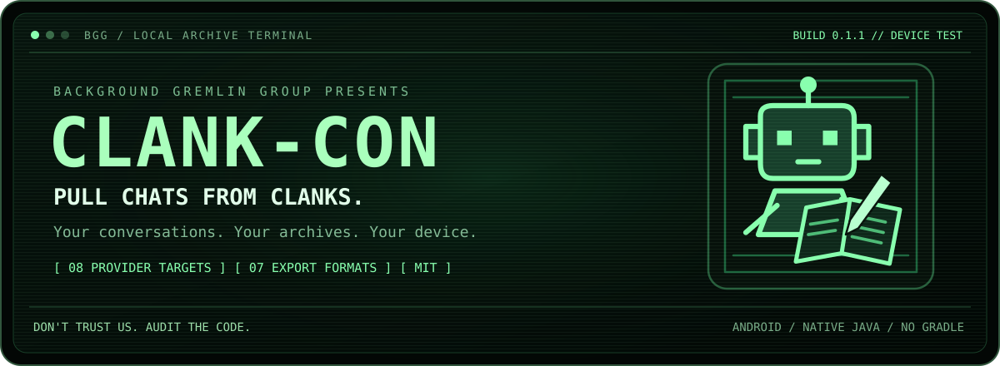
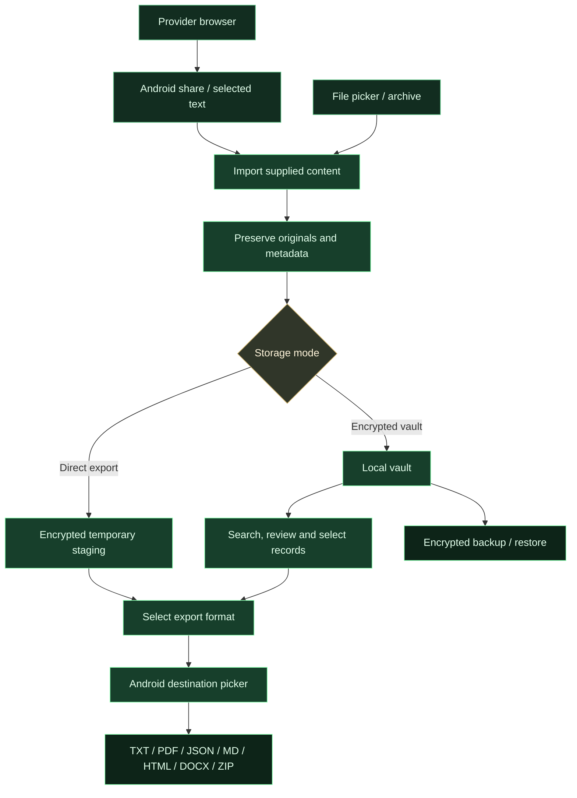
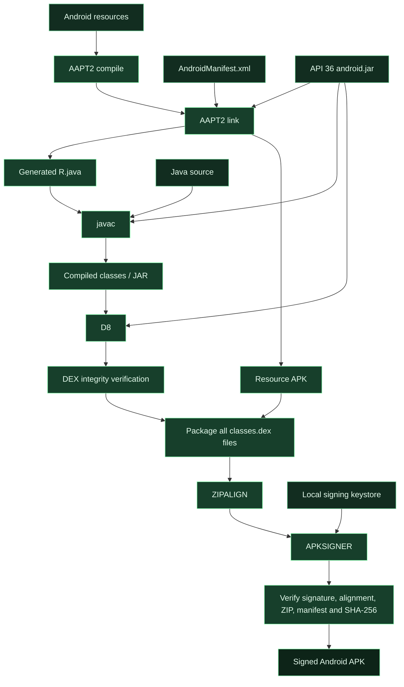

<div align="center">



# CLANK-CON

**Pull chats from clanks. Keep the originals. Own your archive.**

<!-- Platform and project identity -->
[](LICENSE)
[](app/AndroidManifest.xml)
[](app/build.sh)
[](#privacy-and-integrity)

<!-- Recorded build evidence, not live CI -->
[](docs/V0.1.1_EXPORTER_REVIEW.md)
[](docs/V0.1.1_EXPORTER_REVIEW.md)
[](docs/V0.1.1_EXPORTER_REVIEW.md)
[](docs/RELEASE_ACCEPTANCE.md)
[](#provider-compatibility)

[](docs/support.md)

<!-- Capabilities -->
[](#provider-compatibility)
[](#features)
[](#privacy-and-integrity)
[](#build-from-source)

<!-- Live repository statistics -->
[](https://github.com/bggg-gizmo/clank-con/stargazers)
[](https://github.com/bggg-gizmo/clank-con/forks)
[](https://github.com/bggg-gizmo/clank-con/issues)
[](https://github.com/bggg-gizmo/clank-con/commits/main/)
[](https://github.com/bggg-gizmo/clank-con/pulls)

<sub>Build badges refer to the recorded v0.1.1 verification; repository statistics update via Shields.io.</sub>

[Features](#features) · [Compatibility](#provider-compatibility) · [How to use](#application-workflow) · [Build](#build-from-source) · [Audit](#repository-structure) · [License](#license) · [Support](#support-clank-con)

**A Background Gremlin Group project**

</div>

---

> **Don't trust us. Audit and inspect our code for yourself.**

Clank-Con is a standalone Android conversation archiver built for people who want their own AI conversations under their own control. It combines a retro phosphor-green terminal interface with local encrypted storage, structured conversation import, branch inspection and seven export formats.

No hosted archive service. No Clank-Con account. No mandatory subscription. No Gradle. No deliberately hidden capture of credentials or automatic publication of conversations.

## System status

| Channel | State |
| :--- | :--- |
| Application | **v0.1.1 — device-test release** |
| Package | `group.backgroundgremlin.clankcon` |
| Android | API 28–36 build configuration (Android 9 minimum; target API 36) |
| Host tests | 20 passed in recorded v0.1.1 build |
| APK / DEX | Direct build, integrity, alignment and signature verified |
| Device acceptance | In progress |
| Live provider history retrieval | Outstanding — not advertised as working |

The current build is a working-code archival implementation under device testing, **not** a finished universal live-history downloader. Authentication, import, retrieval and export are distinct stages. Successful browser sign-in alone is not evidence of live retrieval.

[Read the v0.1.1 verification report](docs/V0.1.1_EXPORTER_REVIEW.md) · [Release acceptance gates](docs/RELEASE_ACCEPTANCE.md)

## Features

| Module | Function |
| :--- | :--- |
| **SOURCE** | Eight provider destinations, independent persistent WebView profiles A/B, user-initiated popups, system autofill and external browser launch. |
| **IMPORT** | Android share sheet, text-selection action, pasted text, individual or multiple files and supplied archives. |
| **VAULT** | Encrypted originals and metadata, duplicate detection, local search and paged selection. |
| **REVIEW** | Inspect supplied content, original hashes, image previews, ChatGPT graph branches and derived branch records. |
| **EXPORT** | Seven output formats, selected records or entire imported selection, native destination picker and direct-export mode. |
| **BACKUP** | Passphrase-encrypted portable backup, authenticated restoration and conflict handling. |

### Seven export formats

| Format | Purpose |
| :--- | :--- |
| TXT | Readable UTF-8 transcript |
| PDF | Portable document rendering |
| JSON | Metadata and original bytes in Base64 |
| Markdown | Notes, code and portable text workflows |
| HTML | Browser-readable text archive |
| DOCX | Editable word-processing document |
| ZIP | Original files and SHA-256 integrity manifest |

JSON and ZIP preserve original bytes. Other formats render supplied text and metadata; binary assets are not embedded by those writers. Actual Android rendering and interoperability still require device tests. Ordinary exports are plaintext; use the encrypted backup function for protected portability.

## Provider compatibility

Every provider below is a project target and has an official-site browser entry. All support generic, user-supplied file or text import. Structured formats from compatible exporters can be recognized independently of the chosen provider.

| Provider | Official website | Supplied native-format parsing | Live history |
| :--- | :--- | :--- | :--- |
| ChatGPT | [chatgpt.com](https://chatgpt.com/) | Conversation graph JSON / ZIP | Pending |
| Kimi | [kimi.com](https://www.kimi.com/) | Generic import | Pending |
| Claude | [claude.ai](https://claude.ai/) | Generic import | Pending |
| Gemini | [gemini.google.com](https://gemini.google.com/) | Generic import | Pending |
| Grok | [grok.com](https://grok.com/) | Generic import | Pending |
| DeepSeek | [chat.deepseek.com](https://chat.deepseek.com/) | Generic import | Pending |
| Perplexity | [perplexity.ai](https://www.perplexity.ai/) | Generic import | Pending |
| Microsoft Copilot | [copilot.microsoft.com](https://copilot.microsoft.com/) | Generic import | Pending |

### Structured interoperability

- Supplied ChatGPT conversation graphs, including explicit parent links, branch endpoints and source metadata.
- ACE schema v1: original roles, display labels, content, timestamps and source details.
- AI Exporter-compatible role/content JSON arrays: ordered text, model, time, supplied reasoning and citations.
- Generic files and ZIP archive members: original bytes retained without assuming a proprietary schema.

The provider label is not a verified account identity. No format is assumed to contain every server-side message, attachment, branch or project.

## Application workflow



1. Choose a provider or import an existing conversation file.
2. If using DuckDuckGo or another external browser, open a conversation and share its **actual selected content** or a supported file to Clank-Con. A link alone is not the conversation.
3. Review the supplied provider, account label and content.
4. Save it to the encrypted vault, or choose direct export without a retained vault record.
5. Search, select and export records. Use Backup / Restore to move an encrypted archive between installations.

Built-in browser login is separate from external browser login. DuckDuckGo retains its own session; Clank-Con cannot inherit it. External ChatGPT sign-in via passkey was observed in earlier device testing, but the option was not offered in a subsequent test. Independent passkey compatibility and live account retrieval remain unresolved.

## Privacy and integrity

| Layer | Implementation |
| :--- | :--- |
| Vault key | Android Keystore |
| Encryption | AES-256-GCM, authenticated 64 KiB frames |
| Backup key derivation | PBKDF2-HMAC-SHA256, 600,000 iterations, random salt |
| Stream integrity | Authenticated sequence and terminal marker |
| Original files | Byte preservation and SHA-256 integrity metadata |
| Storage | Local encrypted vault or user-selected export destination |
| Browser boundary | Separate app/profile sessions; no cookie or token transfer |

Clank-Con does not implement a separate vault PIN or biometric lock in the current build. Device security still matters. External websites can make their own network requests; local archiving does not make a provider's website offline.

Known limits: content search and rendering are capped at 16 MiB per original, with an explicit graph-parser limit. Larger originals remain available for intact JSON/ZIP export. ZIP expansion can partially succeed before a failed member; the original remains preserved. Backup restore handles ordinary failures, but process termination during the final merge can leave a partial merge.

See [technical documentation](app/README.md) and [verification notes](docs/V0.1.0_VERIFICATION.md) before relying on the application as your only backup.

## Build from source

The application is compiled and signed directly with the supplied Android build tools, without Gradle.



Requirements: an existing extracted JDK 17, Android build-tools r36, an API 36 `android.jar`, Bash, Python 3, ZIP utilities and a locally controlled signing keystore. No SDK installation is performed by the build scripts. The existing tools are supplied separately; they are not redistributed in this repository.

Clone the public repository:

```bash
git clone https://github.com/bggg-gizmo/clank-con.git
cd clank-con
```

Run the provided scripts with your local toolchain paths. Set the variables below to your actual local paths and signing alias before running the commands; supply signing passwords securely through the environment.

```bash
bash scripts/check-direct-toolchain.sh "$JDK_DIR" "$BUILD_TOOLS_DIR" "$ANDROID_JAR"

JAVA_HOME="$JDK_DIR" bash app/test-host.sh

bash app/build.sh \
  "$JDK_DIR" \
  "$BUILD_TOOLS_DIR" \
  "$ANDROID_JAR" \
  "$PWD/out/Clank-Con.apk" \
  "$KEYSTORE" \
  "$KEY_ALIAS"
```

The build requires `CLANK_KEYSTORE_PASS` and `CLANK_KEY_PASS`. Do not commit your signing credentials. Updates to an installed app require signing continuity; a newly generated signing key is not interchangeable with the existing development key.

The script checks every DEX file, required application classes, APK resources, ZIP integrity, alignment, signing certificate and SHA-256. Host tests do not replace on-device verification.

For the recorded v0.1.1 build:

```text
APK SHA-256
9078411107de845ecf75871d50d099a4ce52cde78cf7109e089b58e851f23d22

DEX: 112,748 bytes
HOST TESTS: 20 / 20 PASS
```

No APK release asset is currently published in this repository. Build from source or obtain the separately distributed test build through the project owner, and verify its hash.

## Repository structure

| Path | Contents |
| :--- | :--- |
| [app/](app/) | Native application, Android manifest and build scripts |
| [app/src/](app/src/) | Java source |
| [app/res/](app/res/) | Android resources and launcher icon |
| [app/tests/](app/tests/) | Host-side regression tests |
| [probes/](probes/) | Connection diagnostics |
| [scripts/](scripts/) | Direct toolchain verification |
| [verification/](verification/) | Build and test records |
| [docs/](docs/) | Research, acceptance and development documentation |
| [AGENTS.md](AGENTS.md) | Engineering contract |
| [PROJECT_REQUIREMENTS.md](PROJECT_REQUIREMENTS.md) | Approved project scope |
| [LICENSE](LICENSE) | MIT license |

| Read | Why |
| :--- | :--- |
| [Application documentation](app/README.md) | Exact workflows, local storage and build details |
| [Project requirements](PROJECT_REQUIREMENTS.md) | Complete approved scope |
| [Release acceptance](docs/RELEASE_ACCEPTANCE.md) | Criteria for claiming working provider support |
| [Authentication research](docs/AUTHENTICATION_RESEARCH.md) | Browser and session constraints |
| [DuckDuckGo source review](docs/DUCKDUCKGO_BROWSER_REVIEW.md) | Popup, autofill and passkey compatibility findings |
| [Exporter source review](docs/V0.1.1_EXPORTER_REVIEW.md) | Inspected upstream projects, interoperability and tests |
| [Coordination log](docs/COORDINATION_LOG.md) | Development history and outstanding work |
| [Engineering contract](AGENTS.md) | Rules for contributors and development agents |

No code from the inspected upstream exporters or DuckDuckGo was incorporated. Their implementations and formats informed the research; Clank-Con's implementation is independently authored. Upstream projects and Android build tools retain their respective licenses.

## Development status

The current implementation and pending work are documented in [Project requirements](PROJECT_REQUIREMENTS.md), [Release acceptance](docs/RELEASE_ACCEPTANCE.md), and the [v0.1.1 verification report](docs/V0.1.1_EXPORTER_REVIEW.md). Live provider retrieval, authentication compatibility, and full device acceptance remain outstanding.

## Contributing

Contributions are welcome. Use synthetic fixtures, preserve existing functionality, document verification and never include credentials or private conversation data. The project uses direct Android builds without Gradle, Git LFS or paid GitHub Actions.

## Support Clank-Con

Optional Monero (XMR) donations support development, testing and maintenance.

<p align="center">
  
</p>

**Monero receiving address**

```text
82uPeBbNAa6JYmeTpFtSdLXsbGnvQozcKDyHRnwE4QrARk1LYvMHLXcebQATVNNA1ZJj3eAeTsdx4aVpmxLonYQqCVNx6WL
```

Scan using a Monero wallet or copy the address. Verify the receiving address before sending. [Donation information](docs/support.md).

## License

**MIT — Copyright (c) 2026 Background Gremlin Group.**

Use, inspect, modify, redistribute, sublicense and sell copies under the terms of the [full MIT license](LICENSE). Retain the copyright and permission notices. The software comes without warranty.

Clank-Con is an independent project, not affiliated with any of the listed AI providers or browser vendors.

---

<div align="center">

**BACKGROUND GREMLIN GROUP**

*Your conversations. Your archives. Your device.*

</div>
