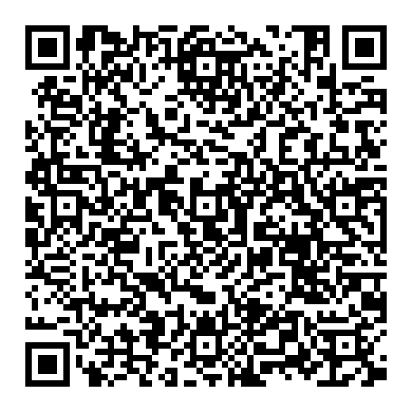

# Support Clank-Con

Clank-Con is an independent MIT-licensed open-source project by Background Gremlin Group. If you find it useful and would like to support ongoing development, testing and maintenance, optional Monero (XMR) donations are welcome.

## Monero (XMR)

<p align="center">
  
</p>

**Receiving address**

```text
82uPeBbNAa6JYmeTpFtSdLXsbGnvQozcKDyHRnwE4QrARk1LYvMHLXcebQATVNNA1ZJj3eAeTsdx4aVpmxLonYQqCVNx6WL
```

Scan the QR code with a Monero wallet or copy the full address above. Verify that your wallet shows the same receiving address before confirming a payment. Donations are voluntary and are not required to use, build or modify Clank-Con.

Use the Monero network only. This is a direct cryptocurrency donation address, not a recurring GitHub Sponsors subscription.

Thank you for supporting open-source development.

[Return to Clank-Con](../README.md)
